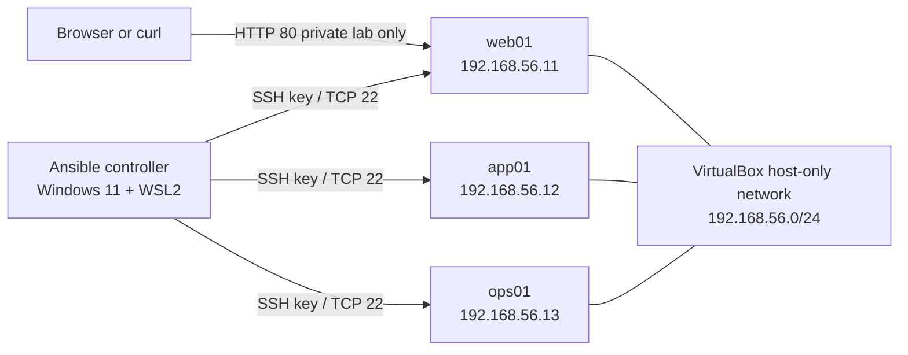

# Linux Infrastructure Automation with Ansible

A personal portfolio project that manages a private three-server Ubuntu lab with Ansible, Bash, Nginx, SSH, UFW, systemd, logrotate, and validated backup tooling. This is a learning environment, not a production deployment or employer project.

## Architecture



| Server | Configuration | Allowed lab traffic |
|---|---|---|
| `web01` | Baseline, users, SSH, UFW, logging, backups, Nginx | SSH 22 from controller CIDR; HTTP 80 from lab CIDR |
| `app01` | Baseline, users, SSH, UFW, logging, backups | SSH 22 from controller CIDR |
| `ops01` | Baseline, users, SSH, UFW, logging, backups | SSH 22 from controller CIDR |

No public SSH, paid cloud resources, passwords, or private keys are used.

## What is implemented

- Inventory, `group_vars`, `host_vars`, `ansible.cfg`, `site.yml`, tags, variables, handlers, and templates.
- Roles: `common`, `users`, `ssh_hardening`, `firewall`, `nginx`, `logging`, and `backup`.
- Preflight verifies key-based SSH, remote Python, sudo, and the exact public key before hardening.
- UFW allows controller SSH before enabling default-deny inbound policy.
- Nginx includes `/healthz`, secure headers, configuration validation, systemd enablement, and HTTP verification.
- A systemd timer runs Bash health checks; logrotate manages their output.
- Backups include SHA-256 validation. Restore extracts to staging and refuses destination `/`.
- PR CI runs yamllint, ansible-lint, and syntax checks only; it never contacts infrastructure.

## Quick start

```bash
git clone https://github.com/AhmedZaki2206/linux-ansible-infrastructure-automation.git
cd linux-ansible-infrastructure-automation
python3 -m venv .venv
source .venv/bin/activate
make install
make lint
make syntax
make lab-up
make bootstrap
make configure
make test
make idempotency
make status
```

Run from WSL2/Linux. The full lab requires VirtualBox 7, Vagrant 2.4+, Python 3.11+, Git, OpenSSH, curl, Make, approximately 3 GB free RAM, and 10 GB disk.

Bootstrap creates `~/.ssh/ansible_lab_ed25519` if absent and installs only its public key through `vagrant ssh`. It preserves the Vagrant console recovery path.

## Safe workflow

1. `make lab-up` creates three private VMs.
2. `make bootstrap` creates the dedicated `ansible` account and verifies key access.
3. `playbooks/preflight.yml` refuses hardening unless SSH, sudo, and the controller key are verified.
4. SSH configuration is backed up and validated with `sshd -t` before reload.
5. UFW enables only after SSH and role-specific allow rules exist.
6. Nginx is validated, reloaded through a handler, and checked through `/healthz`.

Recovery: `vagrant ssh <host>`, then inspect or restore `/etc/ssh/sshd_config.pre-ansible`.

## Operations

```bash
./scripts/configure.sh --tags nginx
make test
make idempotency
make logs HOST=web01
make backup HOST=ops01
make restore HOST=ops01 ARCHIVE=/var/backups/ansible-lab/<archive>.tar.gz
make lab-down
```

The restore is staged under `/tmp/ansible-lab-restore-*`; it never overwrites live configuration automatically.

## Container alternative

```bash
ssh-keygen -t ed25519 -f ~/.ssh/ansible_lab_ed25519 -N ''
docker compose -f containers/compose.yml up --build -d
ansible-playbook -i inventory/containers/hosts.yml playbooks/container-connectivity.yml
docker compose -f containers/compose.yml down
```

Containers validate SSH and Ansible connectivity only. They do not reproduce a real systemd boot or UFW behavior. Do not run `site.yml` against the container inventory.

## Security and limitations

- The dedicated lab automation identity has `NOPASSWD: ALL` because general Ansible modules execute privileged Python. It is isolated to disposable VMs and is not claimed as production least privilege.
- Host keys are checked. Refreshing fingerprints is appropriate only after recreating this disposable lab.
- HTTP has no TLS because it is private-only. Backups are local configuration backups and unencrypted at rest.
- No HA, central logging, secrets manager, monitoring stack, or production patch-approval workflow is implemented.

## Troubleshooting

- `UNREACHABLE`: check `vagrant status`, IPs, key, `known_hosts`, and UFW.
- `Permission denied (publickey)`: rerun `make bootstrap`, then verify `.ssh` ownership and modes.
- sudo error: validate `/etc/sudoers.d/90-ansible-bootstrap` through the Vagrant console.
- Nginx: use `sudo nginx -t`, `systemctl status nginx`, and `journalctl -u nginx`.
- Idempotency: rerun with `-vv`, identify the task that changes, and prefer a module or correct `changed_when`.

## Documentation

- [Tool installation and usage guide](docs/TOOLS_GUIDE.md)
- [Step-by-step guide](docs/STEP_BY_STEP_GUIDE.md)
- [Architecture explained](docs/ARCHITECTURE_EXPLAINED.md)
- [Hands-on labs](docs/HANDS_ON_LABS.md)
- [Interview preparation](docs/INTERVIEW_PREPARATION.md)
- [Actual validation results](docs/VALIDATION_RESULTS.md)

## Screenshot checklist

Capture only after real execution: three running VMs, Ansible ping, first/second recaps, `/healthz`, systemd/UFW status, backup/checksum/staged restore, and GitHub Actions.

## License

MIT. See `LICENSE`.

