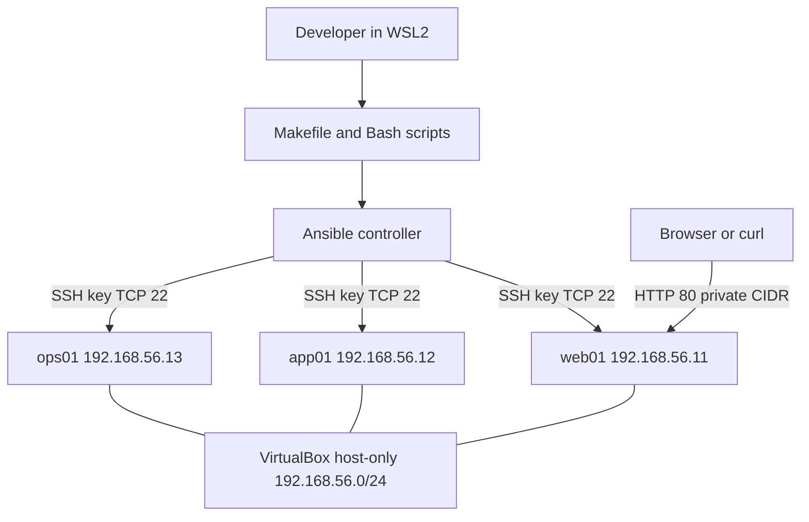
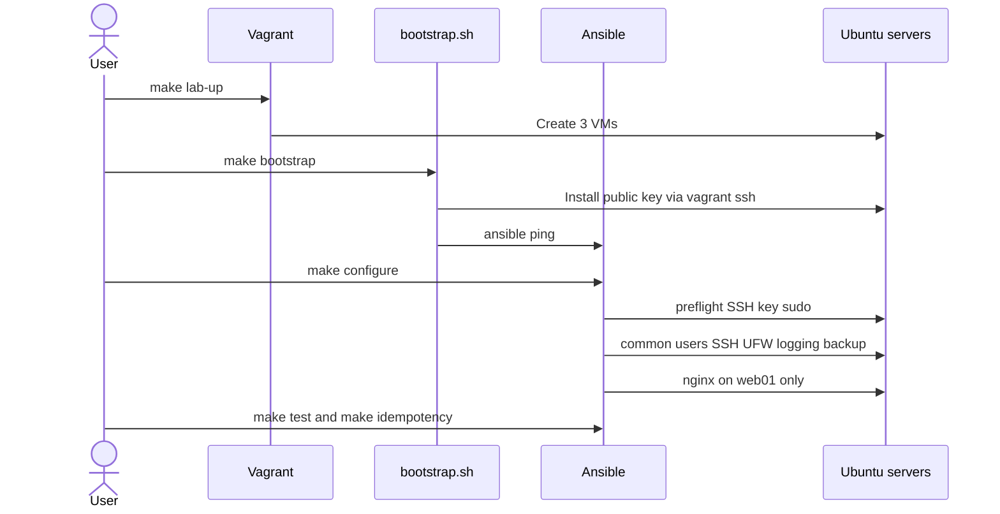

# شرح الـ Architecture الفعلية

## المكونات

الـ controller مش VM رابعة؛ هو WSL2 أو Linux host. `Vagrantfile` ينشئ 3 Ubuntu 24.04 VMs على private network. مفيش public SSH أو cloud.

## Execution flow

## الملفات الرئيسية

- `inventory/lab/hosts.yml`: hosts/groups والـ private IPs.
- `group_vars/all.yml`: shared security, packages, backup وlogging values.
- `group_vars/web_servers.yml`: Nginx وHTTP CIDR.
- `host_vars/*`: وصف كل node.
- `ansible.cfg`: inventory، roles path، host-key checking وSSH pipelining.
- `site.yml`: orchestration؛ preflight ثم baseline ثم Nginx.
- `playbooks/preflight.yml`: بوابة الأمان قبل SSH/UFW.
- `roles/*`: وحدات قابلة لإعادة الاستخدام.
- `scripts/*` و`Makefile`: lifecycle commands.

## الـ roles

| Role | ماذا ينفذ | Safety/Idempotency |
|---|---|---|
| `common` | packages، timezone، upgrades config، health script | `apt`, `timezone`, `template` modules |
| `users` | group/user/public key/sudoers | locked password، `visudo -cf` |
| `ssh_hardening` | UFW SSH allow، backup، sshd drop-in | key assertion، `sshd -t`، reload handler |
| `firewall` | default deny incoming، role-specific rules | SSH allow قبل enable |
| `nginx` | package/site/page/service/health | `nginx -t` handler وHTTP 200 check |
| `logging` | systemd service/timer وlogrotate | daemon reload فقط عند change |
| `backup` | backup/checksum/staged restore scripts | restore يرفض `/` |

## Network flow

- SSH: `192.168.56.0/24 -> targets:22`؛ مش `0.0.0.0/0`.
- HTTP: lab CIDR إلى `web01:80` فقط.
- outbound: UFW يسمح به لتثبيت packages؛ ده trade-off مناسب للlab.
- app01 وops01 مش عليهم HTTP rule.

## Security decisions والقيود

- `PasswordAuthentication no` و`PermitRootLogin no` بعد إثبات الـ key.
- `known_hosts` مفعّل. refresh مسموح فقط بعد recreate للـ disposable VMs.
- automation user عنده `NOPASSWD: ALL`: ده مطلوب لتشغيل general Ansible modules، لكنه lab limitation ومش least privilege production account.
- backups local وغير encrypted؛ configuration demo فقط.
- مفيش TLS، HA، central logging أو secrets manager.
- container alternative لا يختبر systemd/UFW؛ Vagrant هو المسار الأساسي.

